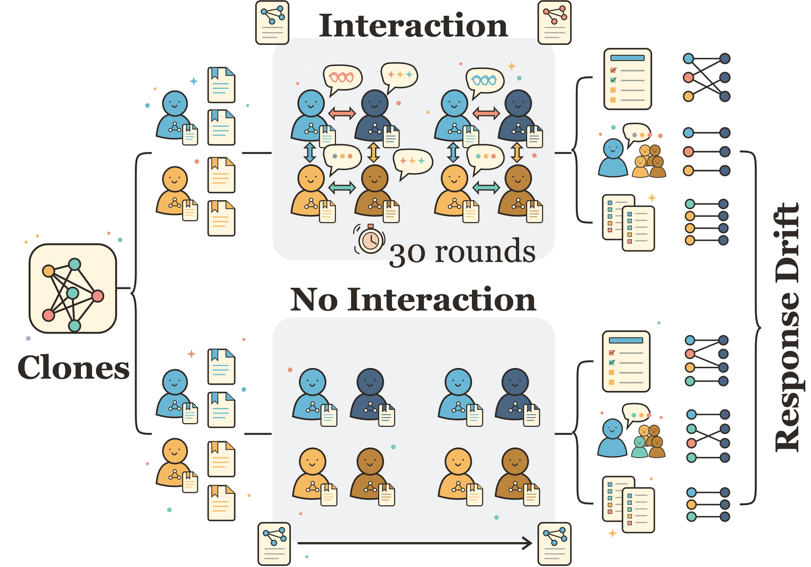
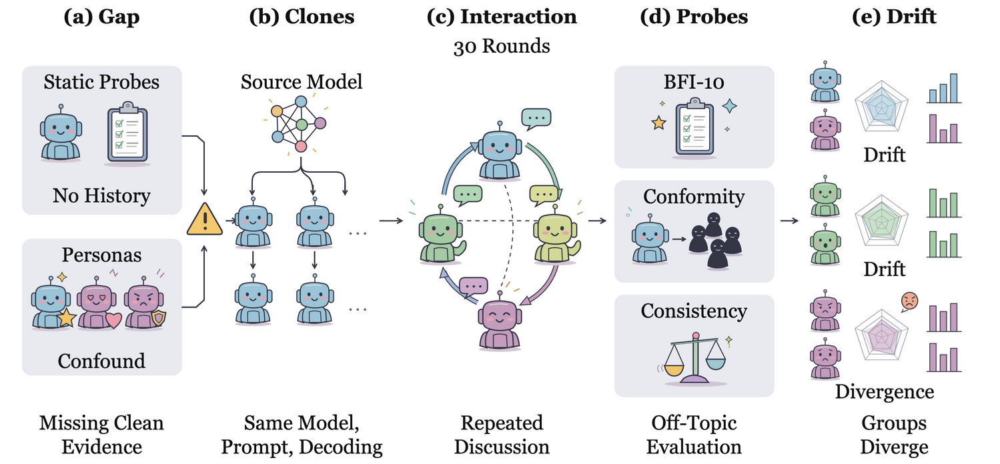
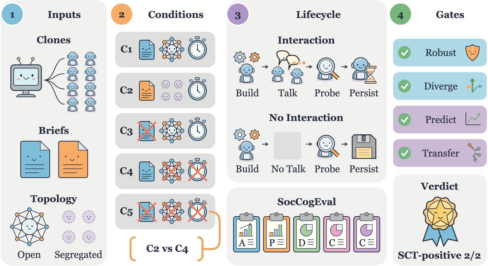
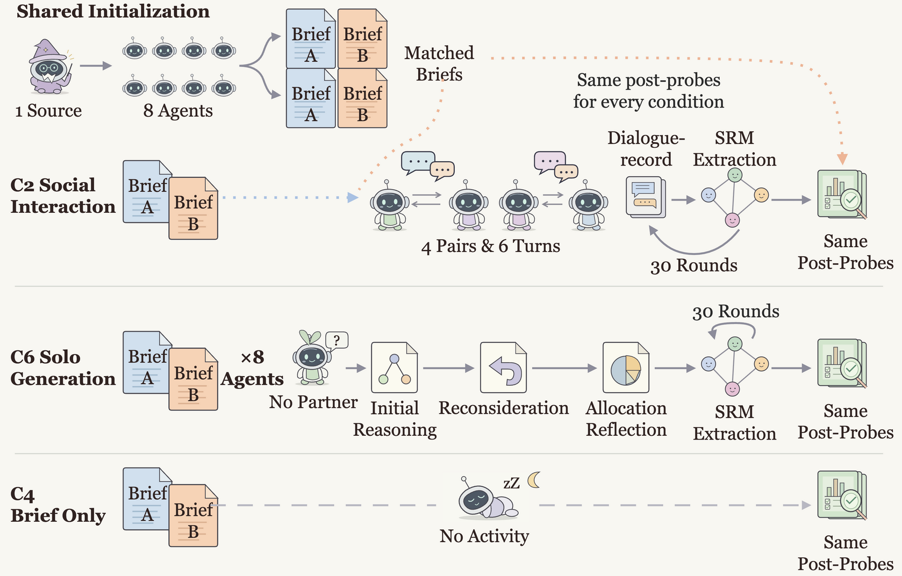
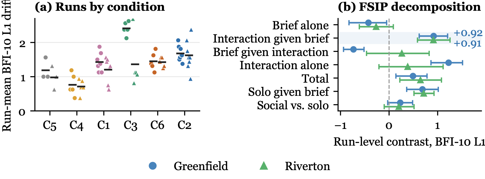
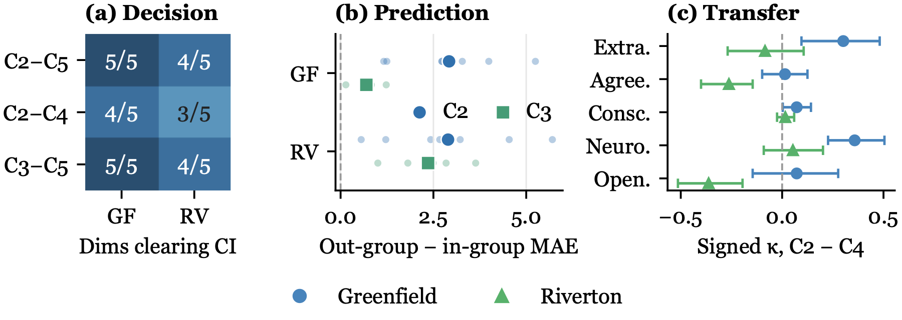
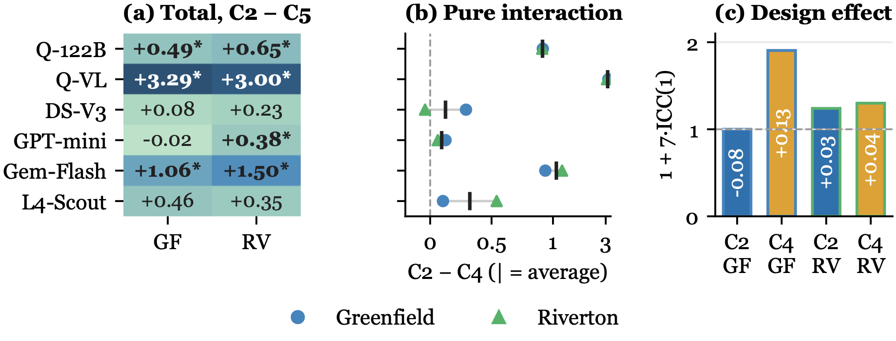

<div align="center">

# Social Interaction Breaks Replicate Independence in Controlled-Clone LLM Agents

**Yandan Zheng · Haoran Luo · Anh Tuan Luu**

**NeurIPS 2026 (poster)**

[📄 Paper (PDF)](paper/main.pdf) · [🧪 Reproduce offline](#reproduce-the-paper-numbers-offline) · [📚 Citation](#citation)



</div>

> **TL;DR.** Multi-agent evaluations and social simulations treat copies of one LLM as interchangeable replicates, even after they talk to each other. We test this with bit-identical clones whose only initial difference is a private brief. Thirty rounds of interaction move their answers on an off-topic BFI-10 inventory by **+0.917** and **+0.912** L1 units in two unrelated scenarios, relative to the same briefs without interaction. Interacting clones are not independent replicates unless paired no-interaction controls show otherwise.

This repository contains **SocCogEval**, a controlled-clone assay for *Social Cognitive Transfer* (SCT), and **CogClaw**, the agent runtime behind it. It includes the experiment code, the selected raw measurements, an offline script that recomputes every reported number, and the camera-ready LaTeX source.

## Abstract

Multi-agent LLM evaluations and social simulations create many agents from one model and treat them as comparable replicates, even after the agents interact. This assumption has not been tested with matched controls. We test it with SocCogEval, a controlled-clone assay for Social Cognitive Transfer (SCT), and find that it fails. Agents share the same base model, system prompt, and decoding parameters, and a private brief is their only initial difference. A factorial protocol separates the brief, 30 rounds of interaction, and initialization noise, and a matched solo-generation condition bounds the role of extended generation. On Qwen3-122B-FP8, toggling interaction with the briefs held fixed raises off-topic BFI-10 response-profile drift by Δ=+0.917 on Greenfield (95% CI [+0.620, +1.205], exact p=0.0008) and +0.912 on Riverton ([+0.584, +1.255], p=0.0039), two topically disjoint scenarios. This is about 0.18 Likert points per factor (g=+1.07 and +0.96). Brief-only controls do not explain the drift. It is directional across runs, persists under temperature-zero re-probing, and stays positive without typed SRM extraction in exploratory tests, so the extractor is not its source. Solo generation accounts for part of the drift, while social interaction remains highest in both scenarios. Across five more model variants, five of ten (C2)−(C5) cells are positive at α=0.05 with no significant reversal, and all five scenario-averaged (C2)−(C4) contrasts are positive. Interacting clones are not independent replicates unless paired no-interaction controls show otherwise.

## The assay

<p align="center"></p>

SocCogEval asks three nested questions, the **SCT route**:

| Step | Question | Instrument |
|---|---|---|
| **Decision** | Do interacting clones diverge on the discussed budget? | 5-dimension allocation |
| **Prediction** | Do they predict exposed in-group peers better than out-group agents? | Prediction MAE |
| **Transfer** | Does the divergence show up on probes unrelated to the discussion? | **BFI-10 response-profile drift** (primary), conformity, consistency |

The **Factorial Social Interaction Protocol (FSIP)** crosses brief presence with interaction. Eight agents per run discuss one of two allocation scenarios, *Greenfield* (a $10M community grant) or *Riverton* (a $5M workforce transition budget), for 30 rounds.

<p align="center"></p>

| Condition | Brief | Activity | Runs per scenario |
|---|---|---|---:|
| C1 | A for everyone | Open-network interaction | 7 |
| **C2** | **A/B by group** | **Segregated interaction** | **8** |
| C3 | None | Segregated interaction | 5 |
| **C4** | **A/B by group** | **No interaction** | **5** |
| C5 | None | No interaction (initialization floor) | 3 |
| C6 | A/B by group | Solo generation, matched call budget | 5 |

The load-bearing contrast is the **pure-interaction contrast (C2)−(C4)**. It holds the briefs fixed and toggles 30 rounds of interaction. C6 gives every agent the same number of generation and memory calls as C2 but no partner, which bounds the contribution of extended generation and history.

<p align="center"></p>

## Main results

**Pure interaction moves off-topic profiles in both scenarios** (Qwen3-122B-FP8, run-level BFI-10 L1 drift):

| Contrast | Greenfield Δ | 95% CI | exact p | Riverton Δ | 95% CI | exact p |
|---|---:|:---:|---:|---:|:---:|---:|
| **(C2)−(C4) pure interaction** | **+0.917** | [+0.620, +1.205] | **0.0008** | **+0.912** | [+0.584, +1.255] | **0.0039** |
| (C6)−(C4) solo generation | +0.688 | [+0.362, +1.013] | 0.0159 | +0.713 | [+0.513, +0.925] | 0.0079 |
| (C2)−(C6) social vs. solo | +0.230 | [−0.028, +0.484] | 0.1430 | +0.200 | [−0.100, +0.514] | 0.3924 |

<p align="center"></p>

- **Brief alone does not explain it.** Among the five FSIP contrasts, only (C2)−(C4) is positive, large and significant in both scenarios.
- **It survives deterministic re-probing.** Re-probing every frozen C2/C4 state at temperature zero gives +1.227 and +1.094.
- **It does not need the memory extractor.** With typed SRM extraction disabled, (C2)−(C5) stays positive (+1.708 and +0.958; exploratory, 3 vs. 3 runs).
- **It is directional.** Signed factor movements agree across replicas, for example Greenfield extraversion and neuroticism (8/8) and Riverton agreeableness (8/8).
- **Solo generation bounds the mechanism.** The ordering C2 > C6 > C4 holds in both scenarios. Social interaction remains highest.

<p align="center"></p>

**Directional breadth across five more models.** Five of ten (C2)−(C5) cells are positive at α=0.05 with no significant reversal. The matched (C2)−(C4) contrast, three runs per condition and scenario, is positive on average for every model (one-sided exact sign test p=0.031):

| Model | Greenfield | Riverton | Scenario average |
|---|---:|---:|---:|
| Qwen3-VL-32B (text-only) | +3.167 | +3.083 | +3.125 |
| Gemini-2.5-Flash | +0.938 | +1.208 | +1.073 |
| Llama-4-Scout | +0.104 | +0.542 | +0.323 |
| DeepSeek-V3 | +0.292 | −0.042 | +0.125 |
| GPT-4.1-mini | +0.125 | +0.062 | +0.094 |

<p align="center"></p>

**Why it matters.** Agents that share an evolving history share dependence. The run, not the agent, is the unit of replication. Counting the eight agents in a run as independent would overstate the effective sample size by design factors up to 1.91 in our data.

## Reproduce the paper numbers offline

No model calls, GPU or API key are needed. Python 3.10 or later:

```bash
python -m venv .venv && . .venv/bin/activate
python -m pip install -r requirements-dev.txt
python scripts/reproduce_paper.py      # writes results/reproduced/
python -m pytest -q                    # 18 tests
```

`reproduce_paper.py` verifies 672 measurement-file checksums, recomputes BFI scores from the raw ratings of all 168 selected runs, and recomputes the primary and C6 contrasts, signed factors, no-SRM, temperature-zero and cross-model results. It then checks them against the audited reference tables in `results/reference/`.

The camera-ready tables and the extra run-level analyses use only the standard library:

```bash
python paper/analysis/cr_analysis.py . paper/evidence_cr   # run-level tests for every FSIP contrast
python paper/analysis/hedges_c6.py   . paper/evidence_cr   # Hedges' g for the C6 rows
cd paper && python make_tables.py && python make_tables_cr.py
```

## Run new experiments

Live runs need a model service and may incur provider charges. Copy `.env.example` to `.env` and fill in only the endpoints you use.

```bash
python -m pip install -r requirements-models.txt
cp .env.example .env && set -a && . ./.env && set +a

# pure-interaction pair on Greenfield
python run_experiment.py --condition 2 --scenario greenfield --model qwen3-122b-fp8 --repeats 1 --seed 4200 --run-id new_c2
python run_experiment.py --condition 4 --scenario greenfield --model qwen3-122b-fp8 --repeats 1 --seed 4200 --run-id new_c4

# solo-generation control (local vLLM with the frozen serving profile)
python run_c6.py --scenario greenfield --replica 0 --seed 6200 \
  --tokenizer-path "$LOCAL_MODEL_CACHE/qwen3-122b-fp8" --run-id new_c6 --output-dir data --batch-size 8
```

New runs generate new trajectories. They do not recreate the historical serving environment. `qwen3-122b-fp8` is the recorded deployment alias, not a public checkpoint name. Read [docs/REPRODUCIBILITY.md](docs/REPRODUCIBILITY.md) before comparing new results with the paper.

## Repository layout

```
cogclaw/           agent runtime: LLM routing, Social-Relational Memory (SRM), probes, orchestrator, solo generation
scenarios/         Greenfield and Riverton materials and A/B briefs
configs/           condition configurations C1–C5
run_experiment.py  C1–C5 runner
run_c6.py          solo-generation (C6) runner
scripts/           reproduce_paper.py and the original analysis utilities
tests/             runner, routing, memory and run-level inference tests
data/              168 selected runs (config, pre/post measurements, summary) + SHA-256 manifest
results/reference/ audited statistics and temperature-zero sensitivity artifacts
results/legacy/    original agent-level exploratory analyses (not confirmatory)
paper/             camera-ready LaTeX source, PDF, table/figure scripts, editable draw.io figures
docs/              data coverage, reproducibility limits, frozen C6 protocols
```

The compact release leaves out full conversation transcripts, persisted memory checkpoints, exposure streams and model weights. Some original audit utilities need those artifacts, as [docs/REPRODUCIBILITY.md](docs/REPRODUCIBILITY.md) explains.

## Build the paper

```bash
cd paper
latexmk -pdf -interaction=nonstopmode -halt-on-error main.tex
```

`paper/figscripts/` regenerates the result plots (matplotlib, Georgia 9pt), and `paper/figures_src/` holds the editable draw.io sources of Figures 1–4.

## Scope

BFI-10 is used as a fixed, off-topic response-profile probe. We report response-profile drift, not human personality change, and the evidence covers post-interaction transfer within the tested configurations (eight agents, 30 rounds, two scenarios). See the paper's limitations section for details.

## Citation

```bibtex
@inproceedings{zheng2026social,
  title     = {Social Interaction Breaks Replicate Independence in Controlled-Clone {LLM} Agents},
  author    = {Zheng, Yandan and Luo, Haoran and Luu, Anh Tuan},
  booktitle = {Advances in Neural Information Processing Systems (NeurIPS)},
  year      = {2026}
}
```

## License and attribution

Third-party dependencies and sources are listed in [THIRD_PARTY_NOTICES.md](THIRD_PARTY_NOTICES.md). The authors have not yet chosen a project license. Until a `LICENSE` file is added, no open-source license is granted.
