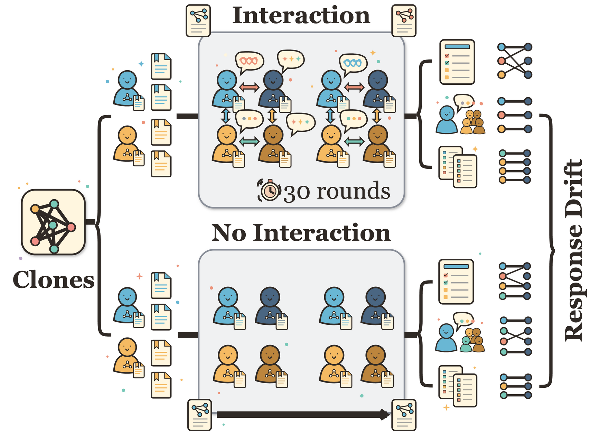
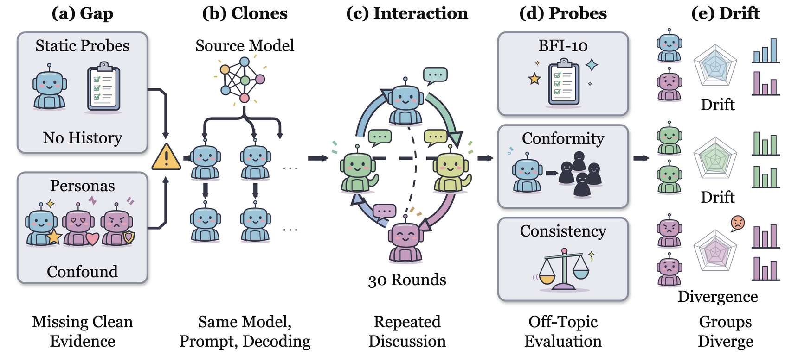
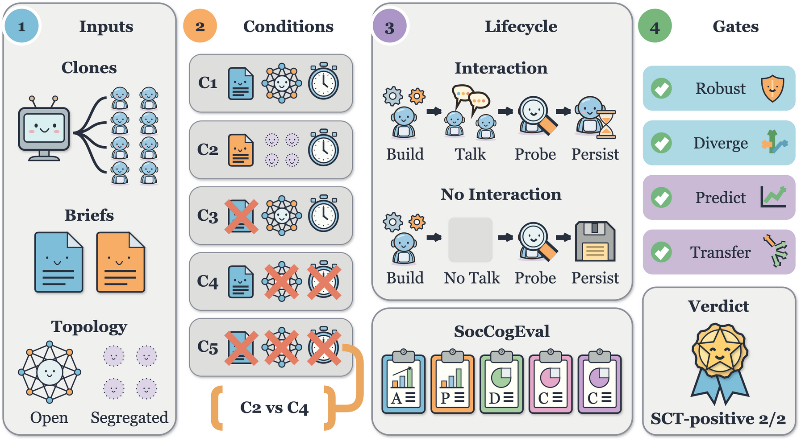
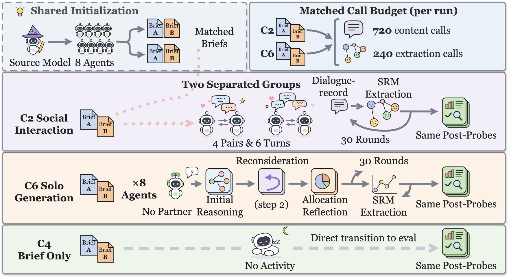
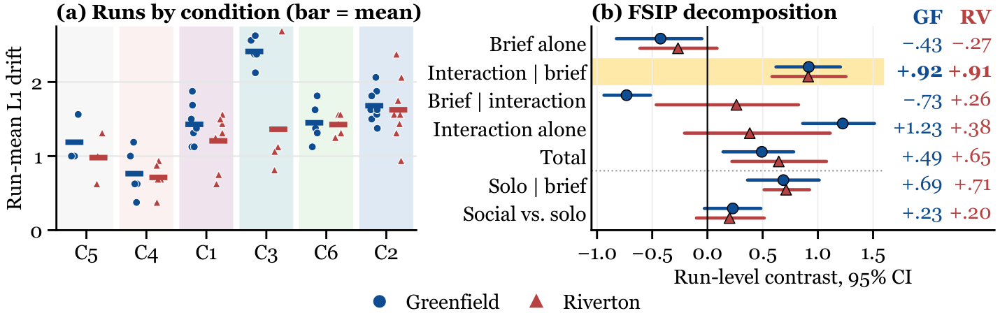
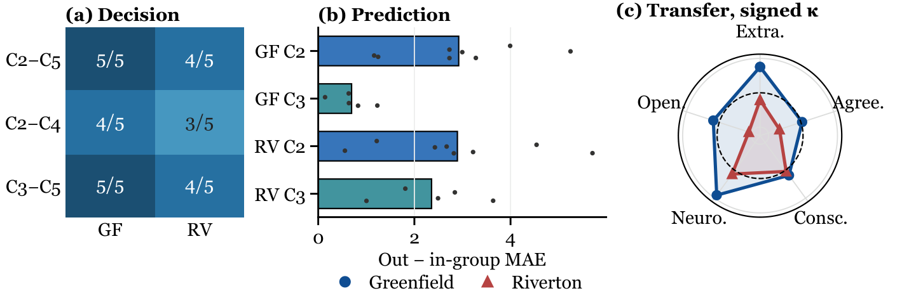
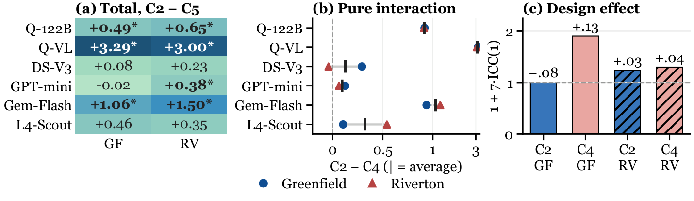
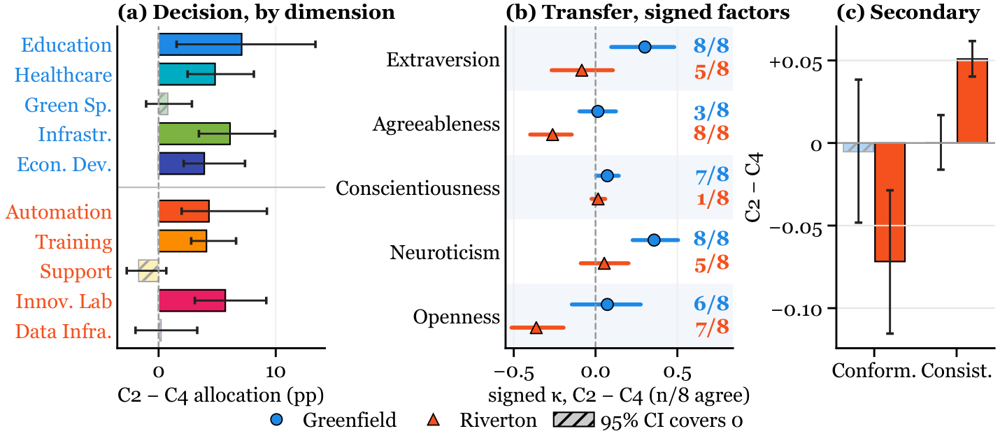

<div align="center">

# SocCogEval

### Social Interaction Breaks Replicate Independence in Controlled-Clone LLM Agents

[](https://neurips.cc/)
[](#)
[](https://www.python.org/)
[](#reproduce-the-paper-numbers-offline)

**Yandan Zheng**, **Haoran Luo**, **Anh Tuan Luu**

</div>

## 🔥 News

- Accepted to **NeurIPS 2026** as a poster.
- Camera-ready code, selected runs, and an offline script that recomputes every reported number are public in this repository. The arXiv version is coming soon.

## 📖 Overview

<p align="center"></p>

Multi-agent LLM evaluations and social simulations create many agents from one model and treat them as comparable replicates, even after the agents interact. We test this assumption with **SocCogEval**, a controlled-clone assay for **Social Cognitive Transfer (SCT)**, and find that it fails. Agents share the same base model, system prompt, and decoding parameters, and a private brief is their only initial difference.

On Qwen3-122B-FP8, toggling 30 rounds of interaction with the briefs held fixed raises off-topic BFI-10 response-profile drift by **Δ̄ = +0.917** on Greenfield (95% CI [+0.620, +1.205], exact *p* = 0.0008) and **+0.912** on Riverton ([+0.584, +1.255], *p* = 0.0039), two topically disjoint scenarios. This is about 0.18 Likert points per factor (*g* = +1.07 and +0.96). **Interacting clones are not independent replicates unless paired no-interaction controls show otherwise.**

<p align="center"></p>

## 🧩 Framework

SocCogEval asks three nested questions along the **SCT route**:

| Step | Question | Instrument |
|---|---|---|
| **Decision** | Do interacting clones diverge on the discussed budget? | 5-dimension allocation vector |
| **Prediction** | Do they predict exposed in-group peers better than out-group agents? | In-group vs. out-group MAE |
| **Transfer** | Does the divergence appear on probes unrelated to the discussion? | **BFI-10 response-profile drift** (primary), conformity, consistency |

The **Factorial Social Interaction Protocol (FSIP)** crosses brief presence with interaction, so each contrast isolates one factor. The load-bearing contrast is the **pure-interaction contrast (C2)−(C4)**: it holds the briefs fixed and toggles interaction.

<p align="center"></p>

| Condition | Brief | Activity | Runs per scenario |
|---|---|---|---:|
| C1 | A for everyone | Open-network interaction | 7 |
| **C2** | **A/B by group** | **Segregated interaction** | **8** |
| C3 | None | Segregated interaction | 5 |
| **C4** | **A/B by group** | **No interaction** | **5** |
| C5 | None | No interaction (initialization floor) | 3 |
| C6 | A/B by group | Solo generation, matched call budget | 5 |

The solo-generation control **C6** gives every agent the same 720 content calls and 240 extraction calls per run as C2, with private generation in place of partners. It bounds how much of the drift comes from extended generation and history alone.

<p align="center"></p>

## 📊 Main Results

**Pure interaction moves off-topic response profiles in both scenarios** (Qwen3-122B-FP8, run-level BFI-10 L1 drift):

| Contrast | Greenfield Δ̄ | 95% CI | exact *p* | Riverton Δ̄ | 95% CI | exact *p* |
|---|---:|:---:|---:|---:|:---:|---:|
| **(C2)−(C4) pure interaction** | **+0.917** | [+0.620, +1.205] | 0.0008 | **+0.912** | [+0.584, +1.255] | 0.0039 |
| (C6)−(C4) solo generation | +0.688 | [+0.362, +1.013] | 0.0159 | +0.713 | [+0.513, +0.925] | 0.0079 |
| (C2)−(C6) social vs. solo | +0.230 | [−0.028, +0.484] | 0.1430 | +0.200 | [−0.100, +0.514] | 0.3924 |

<p align="center"></p>

- **Brief-only controls do not explain it.** Among the five FSIP contrasts, only (C2)−(C4) is positive, large, and significant in both scenarios.
- **It survives deterministic re-probing.** Re-probing every frozen C2 and C4 state at temperature zero gives +1.227 and +1.094.
- **It does not need the memory extractor.** With typed SRM extraction disabled, the effect stays positive (+1.708 and +0.958; exploratory, 3 vs. 3 runs).
- **Solo generation bounds the mechanism.** The ordering C2 > C6 > C4 holds in both scenarios, and social interaction remains highest.

**The SCT route holds from decision to transfer.** Clones separate on the discussed budget, predict exposed in-group peers better than out-group agents, and shift in coherent directions on the off-topic inventory.

<p align="center"></p>

**Directional breadth across five more models.** Five of ten (C2)−(C5) cells are positive at α = 0.05 with no significant reversal, and every scenario-averaged (C2)−(C4) contrast is positive (one-sided exact sign test *p* = 0.031):

| Model | Greenfield | Riverton | Scenario average |
|---|---:|---:|---:|
| Qwen3-VL-32B | +3.167 | +3.083 | +3.125 |
| Gemini-2.5-Flash | +0.938 | +1.208 | +1.073 |
| Llama-4-Scout | +0.104 | +0.542 | +0.323 |
| DeepSeek-V3 | +0.292 | −0.042 | +0.125 |
| GPT-4.1-mini | +0.125 | +0.062 | +0.094 |

<p align="center"></p>

**Why it matters.** Agents that share an evolving history share dependence, so the run, not the agent, is the unit of replication. Counting the eight agents in a run as independent would overstate the effective sample size by design factors up to 1.91 in our data.

**Beyond BFI-10 in Riverton.** The same contrast also shifts the discussed allocation, the signed factor profile, and the conformity and consistency probes.

<p align="center"></p>

## ⚙️ Environment Setup

```bash
conda create -n soccogeval python=3.11
conda activate soccogeval
pip install -r requirements-dev.txt
```

## 🚀 Quick Start

### Reproduce the paper numbers (offline)

```bash
python scripts/reproduce_paper.py
python -m pytest -q
```

This needs no model calls, GPU, or API key. It verifies 672 measurement-file checksums, recomputes BFI scores from the raw ratings of all 168 selected runs, and checks every reported contrast against the audited tables in `results/reference/`.

### Run new experiments

```bash
pip install -r requirements-models.txt
cp .env.example .env    # fill in only the endpoints you use
set -a && . ./.env && set +a

# pure-interaction pair: C2 (interaction) and C4 (briefs only)
python run_experiment.py --condition 2 --scenario greenfield --model qwen3-122b-fp8 --repeats 1 --seed 4200 --run-id new_c2
python run_experiment.py --condition 4 --scenario greenfield --model qwen3-122b-fp8 --repeats 1 --seed 4200 --run-id new_c4

# solo-generation control C6 (local vLLM)
python run_c6.py --scenario greenfield --replica 0 --seed 6200 \
  --tokenizer-path "$LOCAL_MODEL_CACHE/qwen3-122b-fp8" --run-id new_c6 --output-dir data --batch-size 8
```

New runs generate new trajectories and do not recreate the historical serving environment. `qwen3-122b-fp8` is the recorded deployment alias, not a public checkpoint name. See [docs/DATA.md](./docs/DATA.md) and [docs/REPRODUCIBILITY.md](./docs/REPRODUCIBILITY.md) for data coverage and reproducibility limits.

## 🗂️ Repository Layout

```
cogclaw/            agent runtime: LLM routing, Social-Relational Memory (SRM), probes, orchestrator, solo generation
scenarios/          Greenfield and Riverton materials and A/B briefs
configs/            condition configurations C1–C5
run_experiment.py   C1–C5 runner
run_c6.py           solo-generation (C6) runner
scripts/            reproduce_paper.py and the analysis utilities
tests/              runner, routing, memory, and run-level inference tests
data/               selected runs (config, pre/post measurements, summary) with a SHA-256 manifest
results/reference/  audited statistics and temperature-zero sensitivity artifacts
results/legacy/     original agent-level exploratory analyses (not confirmatory)
docs/               data coverage, reproducibility limits, frozen C6 protocols
```

## 🔎 Scope

BFI-10 serves as a fixed, off-topic response-profile probe. We report response-profile drift, not human personality change. The evidence covers post-interaction transfer within the tested configurations (eight agents, 30 rounds, two scenarios).

## 📝 BibTeX

If you find this work helpful for your research, please cite:

```bibtex
@inproceedings{zheng2026social,
 author = {Zheng, Yandan and Luo, Haoran and Luu, Anh Tuan},
 booktitle = {Advances in Neural Information Processing Systems},
 title = {Social Interaction Breaks Replicate Independence in Controlled-Clone LLM Agents},
 year = {2026}
}
```

## 📬 Contact

For questions, please open an issue or contact the corresponding author at `yandan.zheng@ntu.edu.sg`.
