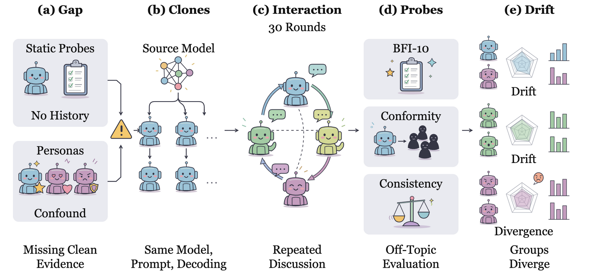

# SocCogEval

Official resources of **"Social Interaction Breaks Replicate Independence in Controlled-Clone LLM Agents"**. Yandan Zheng, Haoran Luo, Anh Tuan Luu. **NeurIPS 2026** \[[paper](./paper/main.pdf)\].

## Overview



Multi-agent LLM evaluations and social simulations treat copies of one model as comparable replicates, even after the copies interact. SocCogEval tests this assumption with controlled clones that share base model, system prompt and decoding parameters, where a private brief is the only initial difference. Thirty rounds of interaction, with the briefs held fixed, raise off-topic BFI-10 response-profile drift by **+0.917** (Greenfield) and **+0.912** (Riverton), exact run-level p = 0.0008 and 0.0039. Interacting clones are not independent replicates unless paired no-interaction controls show otherwise.

The Factorial Social Interaction Protocol (FSIP) compares matched lanes: social interaction (C2), solo generation with the same call budget (C6), and briefs only (C4), all measured with the same post-probes.


## Environment Setup
```bash
conda create -n soccogeval python=3.11
conda activate soccogeval
pip install -r requirements-dev.txt
```

## Quick Start
### Reproduce the Paper Numbers (offline)
```bash
python scripts/reproduce_paper.py
python -m pytest -q
```

This needs no model calls, GPU or API key. It verifies 672 measurement-file checksums, recomputes BFI scores from the raw ratings of all 168 selected runs, and checks every reported contrast against the audited tables in `results/reference/`.

### Run New Experiments
```bash
pip install -r requirements-models.txt
cp .env.example .env    # fill in only the endpoints you use
set -a && . ./.env && set +a

# pure-interaction pair: C2 (interaction) and C4 (briefs only)
python run_experiment.py --condition 2 --scenario greenfield --model qwen3-122b-fp8 --repeats 1 --seed 4200 --run-id new_c2
python run_experiment.py --condition 4 --scenario greenfield --model qwen3-122b-fp8 --repeats 1 --seed 4200 --run-id new_c4

# solo-generation control C6 (local vLLM)
python run_c6.py --scenario greenfield --replica 0 --seed 6200 \
  --tokenizer-path "$LOCAL_MODEL_CACHE/qwen3-122b-fp8" --run-id new_c6 --output-dir data --batch-size 8
```

> For data coverage and reproducibility limits, please refer to [docs/DATA.md](./docs/DATA.md) and [docs/REPRODUCIBILITY.md](./docs/REPRODUCIBILITY.md). The camera-ready LaTeX source, table scripts and editable figures are in the [paper](./paper) folder.

## BibTex

If you find this work is helpful for your research, please cite:

```bibtex
@inproceedings{zheng2026social,
 author = {Zheng, Yandan and Luo, Haoran and Luu, Anh Tuan},
 booktitle = {Advances in Neural Information Processing Systems},
 title = {Social Interaction Breaks Replicate Independence in Controlled-Clone LLM Agents},
 year = {2026}
}
```

For further questions, please open an issue in this repository.

## Acknowledgement

This repo benefits from [HyperGraphRAG](https://github.com/LHRLAB/HyperGraphRAG), [OASIS](https://github.com/camel-ai/oasis), FutureMap, KnowledgeClaw and MiroFish. Thanks for their wonderful works.
